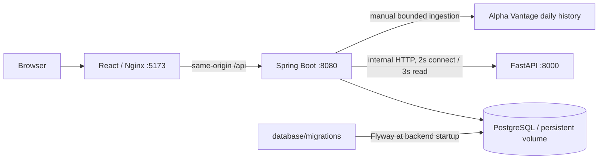

# METIS

Phase 2 local data, training, model registry and prediction integration are implemented and verified with isolated fixtures. Genuine market-data validation remains pending a sufficiently long real local dataset. See [current acceptance](docs/STATUS.md) and [Phase 2 guide](docs/PHASE2.md).

**Financial Intelligence & MLOps Platform** · local research workspace · foundation v0.1.0

METIS combines historical market exploration, deterministic financial analytics, paper portfolios, and explicit model-service availability. The application never seeds market history, predictions, portfolios, or backtest performance. It is a single-user development application without authentication; public deployment requires further hardening.

**Current verification:** frontend production build and interaction tests, Java compilation/unit tests/JAR packaging, and FastAPI tests/live HTTP checks pass on this host. Docker is absent, so PostgreSQL migrations, persistence, Swagger runtime, container builds, and the complete service graph are **not yet verified**. See [STATUS](docs/STATUS.md) for the acceptance record.

## Stack

| Layer | Versions / choices |
|---|---|
| Frontend | React 19.1.1, TypeScript 5.9.2, Vite 7.1.7, Tailwind 3.4.17, React Router 7.9.3, TanStack Query 5.90.2, ECharts 5.6.0, Lucide 0.468.0 |
| Application API | Java 21 target, Spring Boot 3.5.7, JPA, JDBC, Validation, Actuator, Flyway, springdoc 2.8.13 |
| Model service | Python 3.12 container, FastAPI 0.118.0, Pydantic 2.11.9, Uvicorn 0.37.0; pandas 2.3.3 / NumPy 2.3.3 available for future features |
| Persistence | PostgreSQL 17.6, Flyway versioned SQL |
| Build / tests | Maven 3.9.11, JUnit 5, Mockito, Testcontainers, pytest 8.4.2, Vitest 3.2.4, Testing Library |
| Runtime | Docker Compose; four services, no Kubernetes or optional observability stack |

npm dependencies have a committed lockfile. Python direct dependencies are pinned; `requirements.lock.txt` records the resolved local environment and is used as a constraints file. Native wheels remain platform-specific. Maven dependency versions are pinned through the Spring Boot parent/BOM and explicit springdoc version. Image tags are versioned where practical; base tags are not digest-locked.

## Architecture



Spring owns application persistence and financial calculations. Python exposes typed model availability contracts, with no trained artifacts or inference endpoint. The frontend receives no provider key or database credentials.

## Repository

```text
frontend/                 React pages, UI, charts, typed API client, UI tests
backend/spring-boot/      Layered application API, Java tests, Dockerfile
services/ml-api/         FastAPI API/schema/model/feature boundaries, tests
database/migrations/    Authoritative Flyway V1 schema and V2 reference seeds
infrastructure/scripts/ Read-only inspection, env initialization, smoke/browser checks
docs/                   Architecture, API, database, development and acceptance notes
.github/workflows/      UI, Python, Java/PostgreSQL and full Compose checks
```

## Requirements and inspected host

Recommended: 8 GB RAM, Docker Desktop with Linux containers/WSL2 integration, Compose v2, Git, and roughly 4–6 GB free for a first build including images/caches (estimate). The repository should remain on D:. Build images sequentially on this machine.

For native development, use Java 21, Maven 3.9.11+, Node 22.12+ LTS, Python 3.11/3.12, and PostgreSQL 17. On 23 October 2026 this host had Node 24.13.0, Java 25.0.2, Python 3.13.7, Git, and Ubuntu/WSL2. Java 21 and Python 3.12 are provided by the configured containers, but are not installed natively. Local compilation targets Java 21; local Python tests used 3.13. Docker, Compose, native PostgreSQL and system Maven were not found. A project-local Maven distribution and virtual environment were used for verification.

Initial available space: D: approximately 56.1 GiB, C: approximately 24.2 GiB. No Docker Desktop settings/storage path was found. Repository placement does **not** determine Docker image/volume placement.

## Windows / WSL2 preparation

1. Install Docker Desktop yourself after reviewing its prerequisites and licensing. Enable WSL2 integration for Ubuntu and select Linux containers. No system installation or Windows feature change is performed by this repository.
2. Verify `wsl --status`, `docker version`, and `docker compose version`. WSL2 alone does not imply Docker is available.
3. In Docker Desktop, inspect **Settings → Resources → Advanced → Disk image location** (wording may vary by release). If storage is on C: and space is constrained, use Docker Desktop's supported relocation setting to a dedicated D: directory after backing up important data. Never manually move a running VHDX.
4. Start with around 3 GB WSL/Docker memory and 2 CPUs as a conservative estimate; measure and adjust if builds need more. Do not enable Kubernetes. See [Docker setup](docs/DOCKER_SETUP.md).

The read-only inspection helper is `powershell -File infrastructure/scripts/inspect-environment.ps1`. It prints storage settings selectively and does not dump credentials.

## First launch (PowerShell)

From `D:\QuantOPs\Metis` after Docker Desktop is installed and running:

```powershell
.\infrastructure\scripts\init-env.ps1
# Optionally edit .env and set ALPHA_VANTAGE_API_KEY. Do not share or commit .env.
docker compose config --quiet
docker compose --parallel 1 build
docker compose up -d --wait --wait-timeout 240
.\infrastructure\scripts\smoke.ps1
```

`init-env.ps1` creates `.env` with a random local database password only if the file is absent. If you already copied `.env.example`, fill its empty `POSTGRES_PASSWORD` yourself; Compose intentionally refuses a blank password. Changing that value after a database volume exists does not change the database user's password.

WSL/bash alternative:

```bash
cp .env.example .env
# Edit .env: choose a private POSTGRES_PASSWORD; optionally configure the provider key.
docker compose config --quiet
docker compose --parallel 1 build
docker compose up -d --wait --wait-timeout 240
python3 infrastructure/scripts/smoke.py
```

`smoke.py` creates and deletes a temporary paper portfolio to check CRUD; it never calls a live market provider. Use it on an isolated development/test stack.

| URL | Purpose |
|---|---|
| http://localhost:5173 | METIS frontend, same-origin API proxy |
| http://localhost:8080/swagger-ui/index.html | Java Swagger UI |
| http://localhost:8080/v3/api-docs | OpenAPI JSON |
| http://localhost:8080/api/v1/health | Java, DB, Python and provider status |
| http://localhost:8080/actuator/health | Spring/database container readiness |
| http://localhost:8000/docs | FastAPI OpenAPI UI |
| http://localhost:8000/health | Model service liveness |

All published ports bind to 127.0.0.1. PostgreSQL has no published port. Nginx proxies `/api` to `spring-backend:8080`; Vite uses `127.0.0.1:8080` during native UI development. Cross-origin access is not enabled.

## Explore the application

1. Open Overview. Reference assets and the default watchlist load from PostgreSQL.
2. Search a ticker, or register a US ticker in Markets with a reference company label.
3. In Stock Explorer, click **Fetch history**. Missing credentials, provider failures, and quota limits have explicit messages. No requests run automatically on startup.
4. Switch line/candlestick mode and the date range. SMA, RSI, volatility, Sharpe, drawdown and daily returns are computed by the Java API from the same records used for charts.
5. Create a paper portfolio, add holdings, and refresh the page. Add, edit and remove operations use PostgreSQL APIs. Valuations use the last cached historical close; missing prices and currency mismatches keep complete totals unavailable.
6. Check System Health. A configured API key is not reported as a verified provider connection; health includes the last ingestion result.

## Historical data and limits

The initial adapter uses [Alpha Vantage TIME_SERIES_DAILY](https://www.alphavantage.co/documentation/#daily), compact, unadjusted OHLCV. A free key is required. Compact history provides up to 100 sessions; full history may require a paid plan. The documented [free quota](https://www.alphavantage.co/support/) is generally 25 requests/day, subject to provider changes.

The backend caps local use at 25 calls/day, spaces requests by at least 15 seconds, and caches successful per-asset requests for 12 hours. With retries enabled (maximum one), budget accounting reserves the maximum possible attempts. These local controls cannot account for other applications sharing your key. New dates append idempotently; existing dates are not overwritten. A gap longer than the provider's compact window cannot be backfilled by this adapter. Adjusted close and source timestamps remain null when unsupported; trading date and ingestion timestamp are retained.

S&P 500, NASDAQ, NIFTY and SENSEX cards intentionally show unavailable. Indian market ingestion, FX conversion and real-time quotes are unavailable. See [architecture](docs/ARCHITECTURE.md) for replacement seams and analytics caveats.

## Database migrations

`database/migrations` is the **only** source. Maven includes it as `db/migration` in the application JAR; Docker builds use the repository root context. Flyway executes V1/V2 before JPA validates the schema. Do not copy SQL into another directory, edit applied migrations, or use `ddl-auto=update`. Add a new `V3__description.sql` for the next schema change. No manual database initialization script is needed. See [database](docs/DATABASE.md).

## Tests and native development

```powershell
npm ci --prefix frontend
npm test --prefix frontend
npm run build --prefix frontend

python -m venv .venv
.\.venv\Scripts\python.exe -m pip install -r services/ml-api/requirements-dev.txt -c services/ml-api/requirements.lock.txt
Push-Location services/ml-api
..\..\.venv\Scripts\python.exe -m pytest -q
Pop-Location

mvn -B -ntp -f backend/spring-boot/pom.xml verify
```

On this host, Maven is available at `.tools/apache-maven-3.9.11/bin/mvn.cmd`. Use `'-Dmaven.repo.local=D:\QuantOPs\Metis\.cache\m2'` to reuse the project-local cache. `mvn test` runs unit/API tests; `mvn verify` also runs PostgreSQL Testcontainers tests, which explicitly skip when Docker is absent. CI checks Docker availability before running them and separately builds/starts Compose. Live providers are never used by automated tests.

[Development guide](docs/DEVELOPMENT.md) covers native services, browser checks and smoke checks. Existing verification does not prove the container runtime works; CI has been authored but not executed here.

## Shutdown and data safety

```powershell
docker compose stop
# Or remove this stack's containers/network while preserving its named database volume:
docker compose down
```

Do **not** append `-v` unless deliberately deleting this application's database. Do not run global Docker prune commands. Back up the database before upgrades; see [Docker setup](docs/DOCKER_SETUP.md).

## Resource budget and troubleshooting

Configured runtime memory ceilings total **1,408 MiB**: PostgreSQL 256, Java 768, Python 256, frontend 128. These are limits, not measured consumption; Docker/WSL, build stages, browser, IDE and OS use additional memory. PostgreSQL has 20 connections/64 MB shared buffers, Java Hikari has four connections and a 384 MB heap, Python has one worker and constrained BLAS threads, and each container's logs retain at most two 5 MB files. No training or automatic ingestion runs.

If startup fails, inspect `docker compose ps`, `docker compose logs --tail 80 spring-backend`, and `docker compose logs --tail 80 postgres`. Use `config --quiet` to avoid printing resolved credentials. A backend waiting on PostgreSQL often means an existing volume's credentials differ from `.env`. Do not delete the volume to solve this; recover the original credentials. For low memory, build sequentially and close unrelated applications. Further steps: [troubleshooting](docs/DOCKER_SETUP.md).

## Limitations and next phases

The model service reports no trained model. Strategy execution, backtesting results, training history, evaluation charts, model promotion/deployment, portfolio covariance risk, FX, authentication, MLflow, Redis, Kubernetes, Prometheus and Grafana are deliberately deferred. Strategy parameters and backtest forms store browser-local drafts only. Lists are bounded to protect the development machine; market tables show at most 100 matching assets and price requests at most 1,260 observations across five years.

**Next:** verify the full Compose stack and PostgreSQL acceptance checks on Docker, configure a real provider key, inspect data quality and split handling, then design temporal feature engineering and walk-forward model validation. See [roadmap](docs/ROADMAP.md), [API](docs/API.md), and [status](docs/STATUS.md).
